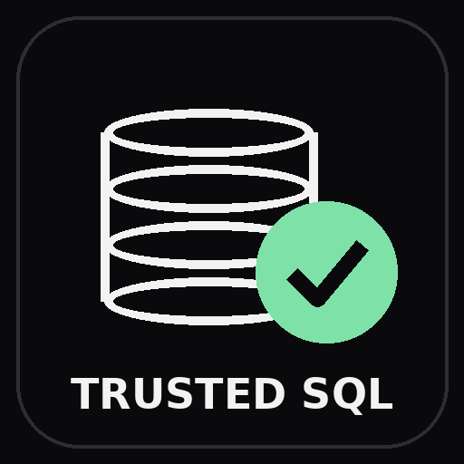

<p align="center"></p>

# Trusted SQL Analyst — is your SQL answer right?

**A paid AI-agent skill** for Claude Code, Codex, Cursor and Gemini CLI. It turns plain-English
questions into SQL **and then double-checks the answer** like a careful senior analyst: it maps the
database first, keeps a glossary of what columns and business terms mean, runs **25 automatic
checks** for silent mistakes, proves the number with **a second query written a different way**,
and explains the result in plain English with its assumptions.

**[Get it on Agensi — $9.99](https://www.agensi.io/creators/muhammad-shahmeer)** ·
[Results page](https://m-shahmeer-kz.github.io/trusted-sql-analyst/)

> This repository is the public showcase: results, examples and test data. The skill itself
> (instructions, the `sqlanalyst.py` checker, references and 46 tests) is sold on Agensi.

---

## Why

Natural-language-to-SQL is not a solved problem. The dangerous failures are not syntax errors —
they are queries that run fine and return a confident, wrong number.

On the Chinook music-store database, "revenue by genre" written the obvious way sums the invoice
total after joining to invoice lines. Rock comes out at **7,720.02**. The real figure is
**826.65** — every invoice was counted once per line. The checker says why, with numbers:

```
FAIL  TSQ105 Join multiplies rows before SUM/AVG/COUNT (fan-out)
After the joins, each `Invoice` row appears 5.44 times on average
(2,240 joined rows for 412 Invoice rows).
```

## Tested honestly

| test | result |
|---|---|
| **Blind test** — 24 new wrong queries written by a separate AI that never saw the tool; checker frozen, run once | **14 / 16** SQL-mechanics mistakes caught · 0 / 8 business-meaning mistakes · 2 / 24 correct queries got a REVIEW note |
| Development cases (32 wrong/right pairs on the same databases) | 31 / 32 wrong queries flagged · 0 / 32 correct queries flagged |
| With vs without the skill (12 business questions, two fresh agents) | both 12 / 12 — the skill's value is catching mistakes, not making a careful model smarter |

*Business-meaning* mistakes (order date instead of ship date, list price instead of the price
charged) are valid SQL for a different question: no checker can see them from SQL and data. The
skill handles them with the glossary step and the second-query cross-check — not measured above,
and never claimed. Details: [results/RESULTS.md](results/RESULTS.md) and every case in
[results/](results/).

Databases: Chinook (music store), Northwind extended (trading, 609,283 order lines) and Sakila
(DVD rental). Profiling takes 0.05–2.8 s; a check takes a median of 0.005 s.

## What it checks

- **Joins** — fan-out double counting with the measured factor · rows dropped by INNER JOIN ·
  joins without a condition · LEFT JOIN undone by WHERE · COUNT(*) after LEFT JOIN
- **NULLs** — NOT IN with a NULL in the subquery · `= NULL` · `<>` / `NOT LIKE` dropping NULL rows ·
  AVG skipping NULLs
- **Text & values** — 'usa' vs 'USA ' · values that do not exist (closest matches shown) · LIKE
  that also matches other categories · comma-separated lists matched with `=`
- **Dates** — BETWEEN / `<=` dropping the last day when values carry a time · `=` on a timestamp ·
  non-ISO dates stored as text
- **Grouping & maths** — non-grouped columns · grouping by a name that merges different people ·
  integer division · AND/OR without brackets · LIMIT without ORDER BY
- **The result itself** — which filter emptied it · duplicate groups · groups that do not add up ·
  NULL groups · impossible percentages

## How your agent uses it

1. Maps the database once (`schema.md`): keys, measured joins, orphans, messy values, date formats.
2. Pins down the question in a glossary: metric definition, grain, time window.
3. Writes the SQL with the trap list in mind.
4. Runs the checks on the query **and its real result**.
5. Proves the number with a second query by a different route.
6. Answers in plain English: number, method, assumptions, checks, SQL.

Works with SQLite, DuckDB, CSV/Parquet/Excel folders (via DuckDB), and Postgres/MySQL through
SQLAlchemy. Read-only: writes, file-reading functions and multiple statements are refused; every
query has a timeout. Needs `pip install sqlglot` (+ `duckdb` for files). Tested on SQLite and DuckDB.

## Examples (real outputs)

- [Database map of Chinook](examples/chinook-database-map.md) and the [starter glossary](examples/chinook-glossary-starter.md)
- Checks: [fan-out](examples/check-fanout-revenue-by-genre.md) · [fixed query](examples/check-fixed-revenue-by-genre.md) ·
  [date boundary](examples/check-date-boundary.md) · [NOT IN + NULL](examples/check-not-in-null.md) ·
  [grouping by name](examples/check-name-grouping.md) · [two-route compare](examples/compare-two-routes.md)
- [A full answer set written by an agent using the skill](examples/agent-answers-with-skill.md)

---

Made by [Muhammad Shahmeer](https://m-shahmeer-kz.github.io/) · MSc Data Science, University of
Naples Federico II · © 2026, all rights reserved.
